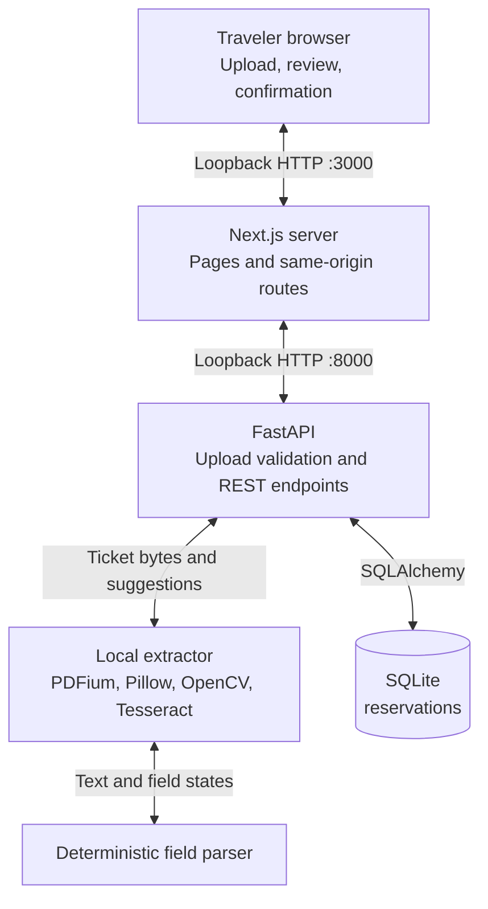
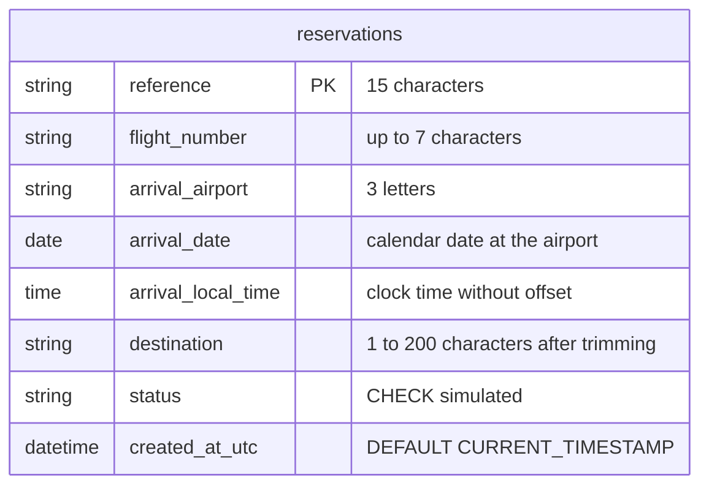

# RayRide CSE491 technical design

RayRide runs on one development machine. A browser opens the Next.js app on loopback port 3000. Next.js sends a small set of requests to FastAPI on loopback port 8000. FastAPI extracts flight suggestions in memory and saves reviewed reservations in one local SQLite file. The Flutter app and local .NET solution are separate.

## Component diagram

| Component | Design choice | Source |
| --- | --- | --- |
| Next.js App Router, React, TypeScript and Tailwind CSS | The browser uses a single origin. Interactive steps keep form state in React and the server renders the saved confirmation from a fresh API read. | [Booking flow](../frontend/components/booking-flow.tsx), [Loopback proxy](../frontend/lib/local-api.ts) |
| FastAPI and Pydantic | Server-side validation is independent of the browser. Pydantic defines response and request shapes, FastAPI exports OpenAPI, and the generated TypeScript types follow the same contract. | [Endpoints](../api/app/main.py), [Schemas](../api/app/schemas.py), [API guide](api.md) |
| PDFium, Pillow, OpenCV and local Tesseract | PDFium tries embedded text before rendering pages for OCR. Pillow decodes images, OpenCV prepares bounded grayscale images, and Tesseract reads English text through process pipes. The parser uses field labels, candidate values and OCR confidence to flag ambiguity. | [Extractor](../api/app/extraction.py), [Field parser](../api/app/ticket_fields.py) |
| SQLAlchemy and SQLite | A single local file supports restart persistence without a separate database server. Startup creates the current table if absent. Schema changes would require a migration plan. | [Database model](../api/app/db.py), [Reservations](../api/app/reservations.py) |

## Ticket to confirmation

1. The traveler chooses one file or opens manual entry. The Next.js route bounds browser uploads and allows expected content types from the same origin. FastAPI independently checks the multipart part, extension, media type, signature, and decoding limits.
2. For PDFs with adequate embedded evidence, the service returns direct suggestions. For other PDFs or supported images, it prepares the image and invokes Tesseract locally. The response marks each flight field as extracted, uncertain, or missing. Only normalized candidate fields and warnings reach the review form.
3. The traveler supplies missing details, enters a destination, and confirms review. An edit clears prior review. The API validates the reviewed JSON even if a client bypasses the form.
4. The API writes a simulated reservation and returns a reference after commit. The browser opens the confirmation using the reference. With the same retry key and normalized details, a repeated request returns the existing reservation. The form holds the key in memory while the page remains open.

## Database diagram

The reference is the only primary key. All eight columns are required, and the database enforces the simulated status. The length and date/time rules shown in the diagram describe API validation and the model's declared types. The creation timestamp is generated by SQLite in UTC and serialized with a UTC offset. The arrival date and clock time stay local to the arrival airport. The retry header and the review flag are transient. A supplied retry key derives the reference and is not stored in a separate column. [Database model](../api/app/db.py) · [Reservation transaction](../api/app/reservations.py)

## Privacy and operating limits

- Use synthetic or anonymized tickets. The local proxy and extractor hold accepted bytes in memory. Tesseract reads from standard input, and its output is parsed in memory. The app saves the reviewed record only. The raw ticket, filename, traveler identity, and OCR transcript have no database fields.
- Keep the web and API bound to loopback. The prototype has no sign-in and a person with access to the service and a reference can look up that record. Confirmation responses are uncached and the web confirmation routes set `Referrer-Policy: no-referrer`. Local server access logs can contain reference paths, so keep logs and SQLite files out of shared evidence.
- Use a dedicated database for demonstrations. Records remain in that file after restart. The prototype has no record deletion or retention interface. Retire a demo database after use according to the team's data handling rules.
- Node.js, Python, and Tesseract run locally for booking. The app serves its own font and image files. Dependency installation and the optional Swagger UI assets may require Internet access. [Privacy test evidence](phase4-verification.md#requirements-traceability) · [Offline demo](final-demo.md)
